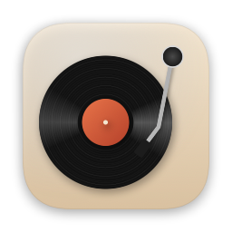
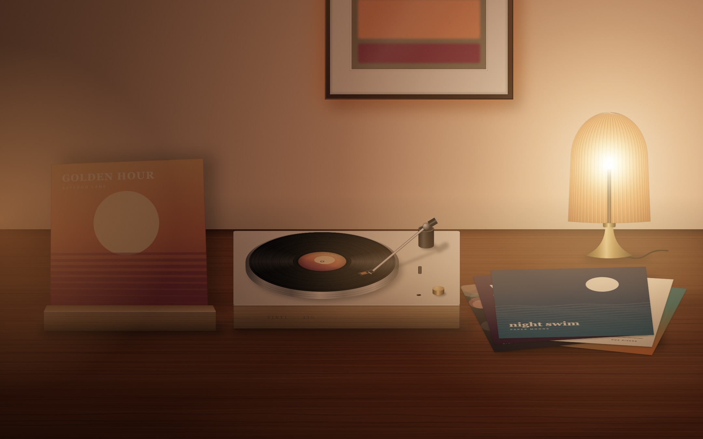
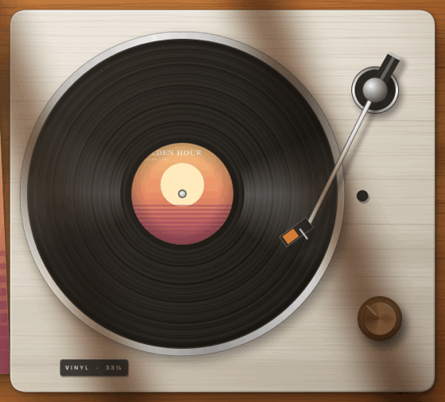
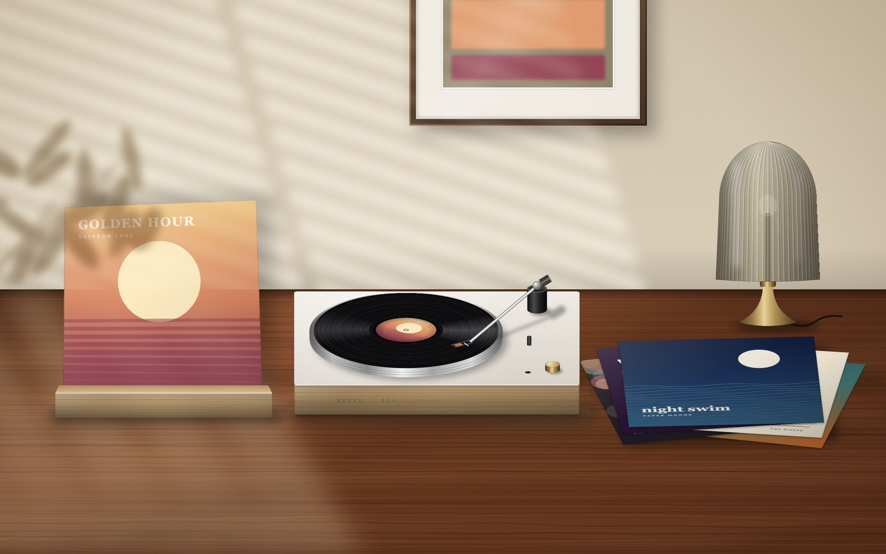
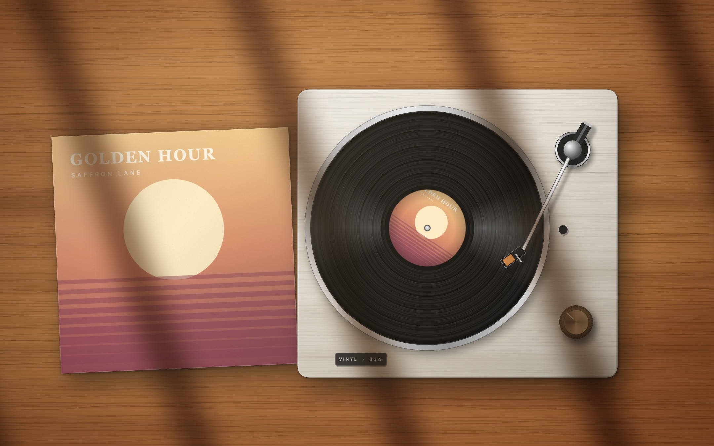
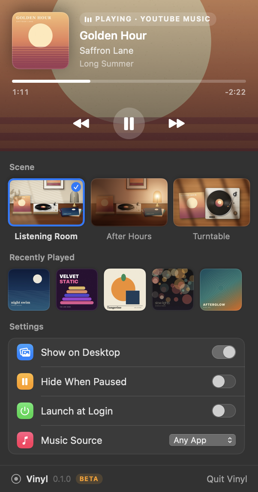
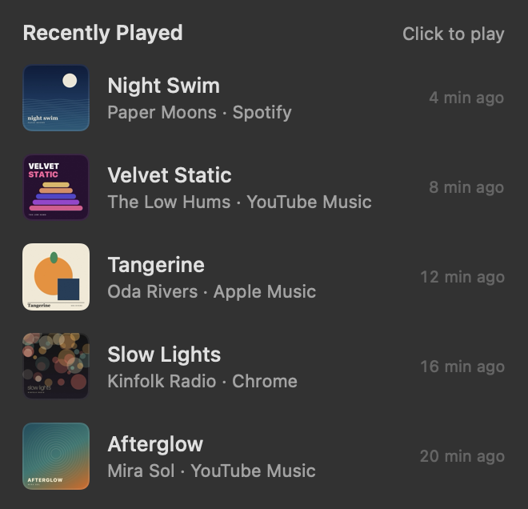
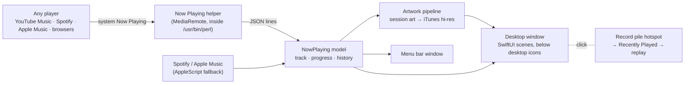

<div align="center">



# Vinyl

### Your music, spinning on your desktop.

Vinyl turns whatever you're listening to into a living desk scene: the album on a stand, the record spinning on a turntable, and your last few records piled up next to it.<br>
**YouTube Music, Spotify, Apple Music, or anything playing in your browser.** Free and open source.

[](https://github.com/app-dialect/vinyl/releases)


[](LICENSE)
[](https://github.com/app-dialect/vinyl/actions/workflows/build.yml)
[](https://github.com/app-dialect/vinyl/stargazers)

<br>



</div>

---

## Put the record on

Streaming took the ritual out of music. Vinyl brings a little of it back, right on your desktop.

Press play anywhere on your Mac, and a few seconds later:

- the **sleeve** of what you're playing is propped up on the desk,
- the **record** drops onto the platter and spins at 33⅓ rpm, with the album art on its label,
- the **tonearm** lifts, swings over and follows the groove as the song plays,
- the **framed print** on the wall repaints itself in the album's colours,
- and the songs you just heard **stack up beside the turntable**. Click the pile to play one again.

Pause, and the platter slowly coasts to a stop. Hit play, and it spins back up.

<div align="center">

</div>

## Three scenes

| Listening Room | After Hours | Turntable |
|:---:|:---:|:---:|
|  |  |  |
| Afternoon sun through the blinds, a plant's shadow on the wall. | The lamp's on, the room is warm, the record keeps turning. | Straight down at the deck, big and bold, with window shadows across the desk. |

## Why people love it

- 🎧 **Works with what you actually use.** YouTube Music and YouTube in Chrome, Safari, Arc, Brave or Edge, plus Spotify, Apple Music, and anything else that shows up in Control Center's Now Playing.
- 💿 **It's alive, not a static picture.** The record spins, the arm tracks the song, and the scene fades between tracks.
- 🗂 **A pile of your last 5 songs.** Hover to lift it, click to see them, click one to play it again (in the same YouTube Music tab, or in Spotify / Apple Music).
- 🖼 **Sharp art, even from the browser.** Browsers only hand over tiny thumbnails, so Vinyl finds a full-resolution cover when the artist matches.
- 🪶 **Light on your Mac.** It uses no CPU while paused or when the desktop is covered, and about 6–8% of one core while a record spins (on our Apple Silicon test Mac).
- 🔒 **Private by design.** No account, no analytics, no tracking. Nothing about your listening leaves your Mac except the cover lookups described [below](#privacy).
- 🧭 **Out of the way.** It lives in the menu bar with no Dock icon, sits behind your desktop icons, and covers every Space and every display.
- 🆓 **Free and open source.** MIT-licensed SwiftUI. Fork it, build your own scene, send a PR.

<div align="center">

&nbsp;&nbsp;&nbsp;&nbsp;

</div>

## Works with

| Player | How Vinyl sees it | Replay from the pile |
|---|---|---|
| **YouTube Music**, **YouTube** (Chrome, Safari, Arc, Brave, Edge) | System Now Playing | ✅ Reopens the song in your YouTube tab |
| **Spotify** (app) | System Now Playing, or directly | ✅ Plays the exact track |
| **Apple Music** | System Now Playing, or directly | ✅ Plays the exact track (library songs) |
| SoundCloud, Tidal, Deezer, podcasts, VLC… | System Now Playing | 🔎 Opens a search for the song |

If it shows up in **Control Center › Now Playing**, Vinyl can put it on the turntable.

---

## Download & install

> [!IMPORTANT]
> **Vinyl is in beta.** It works well day to day, but expect rough edges. Please [report anything odd](https://github.com/app-dialect/vinyl/issues/new/choose); it really helps.

**Requirements:** macOS 14 Sonoma or later, on Apple Silicon or Intel. Developed and tested on macOS 15 (Apple Silicon); the Intel build is untested so far.

1. **Download** the latest `Vinyl-x.y.z-beta.dmg` from [**Releases**](https://github.com/app-dialect/vinyl/releases).
2. **Open the DMG** and drag **Vinyl** into **Applications**.
3. **Open Vinyl** from Applications. A record icon appears in your menu bar, and your desktop becomes a desk.
4. **Play some music.** That's it.

### "Apple could not verify Vinyl…"

The beta isn't notarized by Apple yet (that needs a paid developer account; it's on the [roadmap](#roadmap)), so macOS asks you to confirm the first launch. This happens only once:

1. Try to open Vinyl, then click **Done** on the warning.
2. Open **System Settings › Privacy & Security**, scroll down to **Security**, and click **Open Anyway** next to *"Vinyl" was blocked*.
3. Confirm with **Open Anyway** and your password.

Prefer Terminal? This removes the download quarantine flag:

```sh
xattr -dr com.apple.quarantine /Applications/Vinyl.app
```

Wary of unsigned apps? That's healthy. Every line is in this repo, and you can [build it yourself](#build-from-source) in about a minute.

### Updating

Download the new DMG and replace the app in Applications. Your settings and history are kept.

### Uninstalling

Quit Vinyl from its menu, delete it from Applications, then optionally remove its data and permissions:

```sh
rm -rf ~/Library/Application\ Support/Vinyl
defaults delete app.vinyl.desktop
tccutil reset AppleEvents app.vinyl.desktop
```

---

## Permissions & privacy

Vinyl asks for as little as possible, and only when a feature actually needs it. **Every permission below is optional**: say no, and Vinyl keeps working with that feature scaled back.

| Permission | When macOS asks | Why Vinyl needs it | If you say no |
|---|---|---|---|
| **Automation › Google Chrome / Safari / your browser** | The first time a song plays in that browser | To read the YouTube / YouTube Music tab's link so the pile can replay that exact song, and to load it back into the same tab when you click it | Everything still shows on the desktop; replaying from the pile opens a search instead |
| **Automation › Spotify** | When Spotify is playing, or if you pick *Spotify* as the source | To get the exact track to replay (and, in *Spotify* mode, to read what's playing) | Replay falls back to a Spotify search |
| **Automation › Music** | When Apple Music is playing, or if you pick *Apple Music* as the source | Same as above, for Apple Music | Replay falls back to an Apple Music search |
| **Login Items** | Only if you switch on *Launch at Login* | To start with your Mac | Start Vinyl yourself |

You can review or change these any time in **System Settings › Privacy & Security › Automation** and **› Login Items**.

**Vinyl never asks for** Screen Recording, Accessibility, Full Disk Access, Camera, Microphone, Location or Contacts. It doesn't read your browsing history: it only looks at tab links containing `youtube.com/watch`, and only to find the song that's playing.

### Privacy

- **No accounts, analytics, telemetry or crash reporting.** Vinyl doesn't phone home.
- **Network use is limited to album covers:**
  - Vinyl searches Apple's public [iTunes Search API](https://performance-partners.apple.com/search-api) with the *artist and album/song name* to find a sharp cover;
  - it downloads cover images from Spotify's or Apple's image servers.
- **Stored locally only**, in `~/Library/Application Support/Vinyl`: the last song, its cover, and your 5-song history.

### About the Now Playing helper

macOS 15.4 and later only let Apple-signed programs read the system "Now Playing" session that Control Center shows. Vinyl ships a tiny open-source helper ([`Helper/NowPlayingAdapter.m`](Helper/NowPlayingAdapter.m)) that runs inside macOS's own `/usr/bin/perl` and streams the current track back to the app. That's why you might see `perl` in Activity Monitor while Vinyl runs. If a future macOS update closes this door, Vinyl falls back to talking to Spotify and Apple Music directly.

---

## Using Vinyl

Click the **record icon** in the menu bar:

- **Now playing:** artwork, title, live progress, and play/pause / previous / next for whatever app is playing.
- **Scene:** switch between Listening Room, After Hours and Turntable with live previews of your current album.
- **Recently Played:** your last 5 songs; click one to play it again.
- **Show on Desktop:** turn the scene on or off.
- **Hide When Paused:** show your normal wallpaper whenever nothing is playing.
- **Launch at Login:** start Vinyl with your Mac.
- **Music Source:** *Any App* (recommended), or only *Spotify* / only *Apple Music*.

On the desktop, **hover the pile of records** next to the turntable and **click** to open Recently Played.

## FAQ

<details>
<summary><b>Does it drain my battery?</b></summary>

It's designed not to. The record only animates while music plays and the desktop is visible: when a window covers the desktop, or you're in a full-screen app, the animation stops. The tonearm updates once a second during a song. Paused, Vinyl uses about 0% CPU.
</details>

<details>
<summary><b>Will it replace my wallpaper?</b></summary>

No. Vinyl draws its own window just above your wallpaper and below your desktop icons. Quit Vinyl, or turn off *Show on Desktop*, and your normal wallpaper is right there.
</details>

<details>
<summary><b>My desktop icons near the record pile don't respond to clicks.</b></summary>

The pile is clickable, so it sits just above the icon layer in that one small area. Move those icons, or use the Turntable scene, which has no pile (Recently Played stays in the menu).
</details>

<details>
<summary><b>The cover looks blurry for some songs.</b></summary>

Browsers only pass along small thumbnails. Vinyl swaps in a sharp cover from Apple's catalog when it can confidently match the artist. Uploads that aren't in the catalog (covers, remixes, live sessions) keep the thumbnail.
</details>

<details>
<summary><b>Multiple displays? Spaces? Full-screen apps?</b></summary>

Yes. Every display gets the scene and it stays put on every Space. Whenever the desktop is fully covered (by windows or a full-screen app), the animation pauses.
</details>

<details>
<summary><b>Is it really free? What's the catch?</b></summary>

No catch. MIT licensed, no ads, no data collection. If you like it, a ⭐ helps other people find it.
</details>

---

## Build from source

You need macOS 14+ and the Xcode Command Line Tools (`xcode-select --install`). Full Xcode isn't required.

```sh
git clone https://github.com/app-dialect/vinyl.git
cd vinyl
./build.sh install      # builds Vinyl.app, copies it to /Applications, launches it
```

Other targets:

```sh
./build.sh                  # build/Vinyl.app for this Mac
./build.sh universal        # Apple Silicon + Intel
scripts/make-dmg.sh         # release disk image in build/
```

Render every scene to PNG without touching your desktop (great for reviewing visual changes):

```sh
swift build
swift scripts/make-demo-covers.swift /tmp/covers
.build/debug/Vinyl --snapshot /tmp/vinyl-snaps /tmp/covers/golden-hour.jpg 1440 900 /tmp/covers/night-swim.jpg /tmp/covers/tangerine.jpg
```

## How it works



| Where | What |
|---|---|
| [`Sources/Vinyl/Scenes.swift`](Sources/Vinyl/Scenes.swift) | Scene composition and lighting on a 1440×900 stage that scales to any display |
| [`Sources/Vinyl/Turntable.swift`](Sources/Vinyl/Turntable.swift) | Turntable geometry, spinning record, tonearm physics |
| [`Sources/Vinyl/Objects.swift`](Sources/Vinyl/Objects.swift) | Procedural wood, lamp, frame, album stand, record pile |
| [`Sources/Vinyl/NowPlaying.swift`](Sources/Vinyl/NowPlaying.swift) | Player detection, progress, artwork, history |
| [`Sources/Vinyl/SystemNowPlaying.swift`](Sources/Vinyl/SystemNowPlaying.swift) + [`Helper/`](Helper) | System-wide Now Playing bridge |
| [`Sources/Vinyl/History.swift`](Sources/Vinyl/History.swift), [`Recents.swift`](Sources/Vinyl/Recents.swift) | Recently played, replay, and the clickable pile |
| [`Sources/Vinyl/Desktop.swift`](Sources/Vinyl/Desktop.swift) | Desktop-level windows per display |
| [`Sources/Vinyl/MenuView.swift`](Sources/Vinyl/MenuView.swift) | Menu bar UI |

Everything is drawn in code: no image assets, no third-party dependencies.

## Roadmap

Want to help? These are great places to start. Comment on an issue or open a PR.

- [ ] Signed and notarized builds (no Gatekeeper prompt)
- [ ] Homebrew cask: `brew install --cask vinyl`
- [ ] Automatic updates
- [ ] More scenes: café counter, studio desk, rainy window, record store crate
- [ ] Auto-switch Listening Room ↔ After Hours with sunset
- [ ] Per-display scene choice
- [ ] Lyrics card on the desk
- [ ] Optional "now playing" text on the scene
- [ ] Localization
- [ ] Test and tune on macOS 26 and Intel Macs

## Contributing

Pull requests are very welcome, from a typo fix to a whole new scene. Read [**CONTRIBUTING.md**](CONTRIBUTING.md) for the 2-minute setup, the project layout, and how to attach before/after renders to your PR.

Found a bug? [Open an issue](https://github.com/app-dialect/vinyl/issues/new/choose). Have an idea or want to show off your setup? Start a [discussion](https://github.com/app-dialect/vinyl/discussions).

## Support the project

If Vinyl made your desk a little nicer:

- ⭐ **Star the repo.** It's the single biggest thing that helps others discover it.
- 📸 **Share a screenshot** of your setup in [Show & Tell](https://github.com/app-dialect/vinyl/discussions).
- 🐛 **Report bugs** and 💡 **suggest scenes**.

[](https://star-history.com/#app-dialect/vinyl&Date)

## License

[MIT](LICENSE). Use it, fork it, learn from it.

<sub>Vinyl is an independent open-source project and is not affiliated with or endorsed by Apple, Spotify, Google or YouTube. All product names and trademarks belong to their owners. The album covers in these screenshots are original artwork made for this README.</sub>
